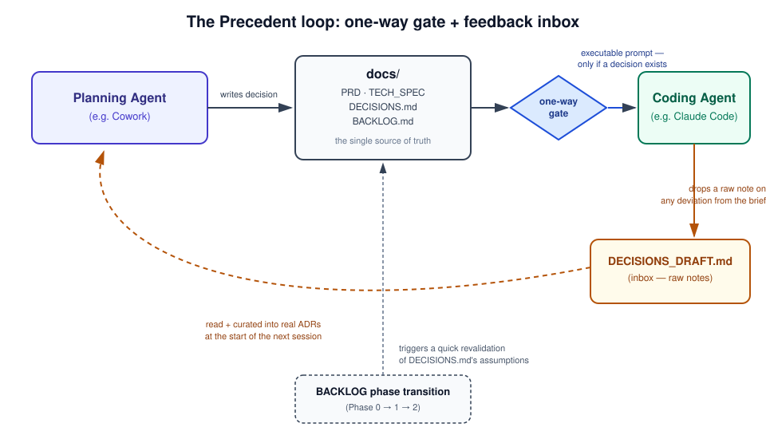

# Precedent

 

**Precedent implements the Project Historian role** — a job most AI-assisted software projects are missing: an agent responsible for preserving decisions, remembering the project, managing its history, reviewing what's gone stale, and sustaining its own methodology, kept distinct from whichever agent actually writes the code.

Concretely: a planning agent (e.g. Claude in Cowork) and a coding agent (e.g. Claude Code) share a small set of files, so decisions flow into code without getting lost — and don't have to be re-litigated every time someone asks "wait, why did we do it this way?"

The name is a legal metaphor: a precedent is a past decision that binds and informs future ones without re-arguing the case from scratch. That's what a decision log is for.

This repo ships two things: this document, and a working `skill/` you can install as-is — one implementation of the Project Historian role, not the only possible one.



## Contents

[A disclaimer, first](#a-disclaimer-first) · [The problem](#the-problem) · [Precedent implements the Project Historian role](#precedent-implements-the-project-historian-role) · [Vocabulary](#vocabulary) · [How it works](#how-it-works) · [Core principles](#core-principles) · [Relationship to known practices](#relationship-to-known-practices) · [Known risks / open questions](#known-risks--open-questions) · [Usage](#usage) · [Sources](#sources)

## A disclaimer, first

Almost nothing here is new. Decision logs, spec-first workflows, context economy — all of these are established, named, in some cases formally standardized practices in software engineering. This repo doesn't claim to have invented them. The point is to honestly show how these known pieces compose in a two-agent (planner + executor) workflow — "here's how we combined it," not "here's what we discovered."

One housekeeping note: this README is the canonical description of the methodology. The accompanying article is a snapshot from its publication date and may lag behind this document — where they differ, this file wins.

This is also a generalized, English version of a personal, Turkish-language, company-specific skill one of us actually uses day to day. The working version has hardcoded categories and a fixed working language that only make sense for that specific setup; this version strips that out so it's usable as a template anywhere.

## The problem

Working with AI agents across sessions produces two distinct kinds of context loss:

1. **Session loss** — re-explaining the project from scratch every new conversation.
2. **Decision loss** — nobody remembers why a decision was made, months later.

There are two broad approaches to this: automatic memory systems (embedding-based retrieval, background servers) and hand-curated, human-edited documents. Precedent picks the second — and that choice is scale-dependent: for a small number of projects with infrequent, deliberate decisions (a small studio, a handful of products), manual curation is both cheaper and more reliable. In a high-volume, many-session environment, an automatic memory system is probably the better fit. This methodology isn't designed for that scenario.

## Precedent implements the Project Historian role

The clearest way to describe what's actually different here: the planning agent isn't just planning, it's filling a role — project historian and curator — that's common in how well-run engineering orgs actually work, but isn't clearly defined in most current AI coding setups, which tend to collapse planning, execution, and memory into one undifferentiated agent. Concretely, that role has five duties, each backed by a specific mechanism in this repo:

- **Preserves decisions.** `docs/DECISIONS.md`, in ADR format, with a lifecycle (Proposed → Accepted → Implemented → Validated, or Rejected / Deprecated / Superseded) instead of a flat "made or not."
- **Remembers the project.** `AGENTS.md`, reloaded at the start of every session, keeping context economical rather than re-explained from scratch.
- **Manages the history.** The `DECISIONS_DRAFT.md` inbox, triaged into Accepted / Rejected / Ignored rather than uniformly cleared — a declined note still leaves a trace instead of vanishing. (In practice this duty is shared: the coding agent writes the raw notes; the historian curates them. The role owns the *record*, not every keystroke into it.)
- **Reviews.** The Session Start Checklist, which checks each ADR's own `Review trigger` (or, by default, the next backlog phase transition) rather than relying on a calendar or on someone remembering.
- **Sustains the methodology.** `skill/DECISIONS.md` — the skill applies its own discipline to its own evolution.

None of these five duties are individually new — see the orchestrator/supervisor comparison below. What's less common is defining the role this concretely, in plain files, without requiring a specific orchestration framework.

Worth being precise about the distinction: **Project Historian is the concept — the role definition. Precedent is one implementation of it**, in the same sense that a "staging area" or a "control plane" name a pattern that any number of specific tools can realize differently. Someone building the same role into a different stack, with different file names, would still be implementing the Project Historian role — they wouldn't need this repo to do it.

## Vocabulary

A handful of terms recur throughout this repo and mean the same thing everywhere they're used:

- **Project Historian** — the role: an agent responsible for preserving, remembering, managing, reviewing, and sustaining a project's decision history, distinct from the agent(s) that execute work.
- **Command Center** — the planning side of the workflow: where decisions get made and recorded, as opposed to where code gets written.
- **Decision Draft** — a raw, unformatted note capturing a deviation or in-the-moment decision, waiting to be triaged.
- **Decision Routing** — the actual problem being solved: making sure a decision reliably reaches the place and moment it's needed next. Not memory (retrieval of the past) — routing (delivery to the future).
- **Decision Lifecycle** — the states a decision moves through over time (proposed, accepted, implemented, validated, or rejected/deprecated/superseded) instead of a flat "made or not."

These aren't established terms outside this repo the way "staging area" or "control plane" are — they're defined here once so they stay consistent, not asserted as adopted vocabulary.

## How it works

Every project starts with this document set:

```
<project>/
  AGENTS.md                ← project brief, <200 lines
  docs/
    PRD.md                 ← what
    TECH_SPEC.md            ← how
    DECISIONS.md            ← why (decision log)
    DECISIONS_DRAFT.md      ← inbox: unprocessed decision notes
    BACKLOG.md              ← when / in what order
  briefs/
    DESIGN_BRIEF.md         ← if design work is involved
```

This structure has no hardcoded root. `project-init` writes into whatever folder is connected to the agent at the time it's invoked, and it asks you to define your own category structure rather than assuming one (mobile/saas/whatever — that's yours to define, not baked in). In practice: connect your actual project workspace before running it, not this repo. If you run it while this repo itself is the connected folder, it'll try to create project folders inside Precedent — this repo is meant to stay a clean reference/template, not accumulate generated projects.

The flow runs through a one-way gate: the planning agent doesn't hand the coding agent an executable prompt until the decision is written to `docs/` first. To be precise about the mechanism: the gate is a standing instruction, not enforced tooling — it's as reliable as the agent following its brief. What it changes is *where the rule sits*: writing the record is defined as a precondition of producing the handoff, not a separate step someone has to remember, so a decision can't leak into code without the handoff itself being incomplete.

That one-way flow isn't enough on its own — there also needs to be a channel running back from execution to planning, or the docs quietly drift out of sync with reality. That's handled with a low-friction inbox: when the coding agent deviates from the brief during implementation, it drops a raw one-line note into `DECISIONS_DRAFT.md`. At the start of the next session, the planning agent triages each note into one of three outcomes — Accepted (promoted to a full ADR), Rejected (still recorded, with a one-line reason, instead of just disappearing), or Ignored (genuine noise, cleared without a trace).

Staleness of past decisions is handled differently too: each ADR can carry its own `Review trigger` — a metric, a shipped version, whatever condition actually matters for that decision — instead of a generic calendar reminder. If a decision doesn't specify one, it defaults to the project's next phase transition in `BACKLOG.md` (Phase 0 → 1 → 2). Either way, before moving forward the assumptions behind the decisions made so far get a quick sanity check.

## Core principles

- **Clarify and document first, build second.** Before writing code, the what, the why, and the biggest risk get written down.
- **Every significant decision is recorded with its rationale.** Decision = what + why + consequences.
- **Unverified assumptions aren't presented as fact.**
- **Blockers get resolved before architecture.** The core uncertainty of a project gets tested before it's built around.
- **Decisions don't flow one way only.** The channel from planning to execution matters as much as the one running back.
- **Context economy.** Only the core documents (PRD + TECH_SPEC + DECISIONS) enter the agent's context; raw logs and experiment output stay out.

## Relationship to known practices

In the interest of honesty, here's where each piece actually comes from.

| In this methodology | Known equivalent | Note |
|---|---|---|
| **Project Historian** (the role) | Orchestrator / supervisor agent pattern | Established in multi-agent frameworks (LangGraph's supervisor pattern, CrewAI's manager agent). The difference here is a concrete 5-duty spec implemented in plain files — no orchestration framework required, just two chat-based agents and a shared folder. |
| `DECISIONS.md` | Architecture Decision Record (ADR) | Michael Nygard, 2011. The format (Context → Decision → Consequences → Status) is close to a direct translation of Nygard's original template. |
| `AGENTS.md` | AGENTS.md | Released by OpenAI in August 2025; adopted early by Cursor, Factory, Google's Jules, and others; donated to the Linux Foundation's Agentic AI Foundation in December 2025. In use across 60,000+ projects. |
| PRD → TECH_SPEC → BACKLOG ordering | Spec-Driven Development / GitHub Spec-Kit | GitHub's 2025–2026 toolkit recommends the same order: spec first, then plan, then tasks. |
| Context economy | Context engineering | Anthropic's September 2025 engineering post: "find the smallest possible set of high-signal tokens." |
| `DECISIONS_DRAFT.md` (inbox) | Structured note-taking / agentic memory | The same Anthropic post describes this pattern: an agent keeps a NOTES.md outside its context window, then reads it back later. |

## Known risks / open questions

- **ADRs are commonly abandoned.** The literature is consistent: teams adopt them enthusiastically, then quietly stop within months. Reasons include maintenance burden falling on whoever has the least context, trivial decisions drowning out load-bearing ones until nobody trusts the log, and the record living outside the daily workflow. The one-way-gate design targets the record living outside the workflow; the Importance field targets trivial decisions drowning out load-bearing ones. The maintenance-burden-on-whoever-has-least-context problem is still open.
- **Poisoning risk in the inbox.** A one-off, unimportant deviation getting promoted into a permanent decision record can teach the agent the wrong lesson persistently. Curation (the planning agent deciding what gets promoted) reduces this risk but doesn't eliminate it.
- **AGENTS.md isn't read natively by every coding agent.** Codex, Cursor, Windsurf, and Cline all read a repo's `AGENTS.md` directly. Claude Code doesn't (as of mid-2026; native support is one of the most-upvoted open requests on its issue tracker, and third-party reports on its status conflict — check the current docs) — `project-init` asks which coding agent you're using and, only if it's Claude Code, creates a one-line `CLAUDE.md` that imports `AGENTS.md` (the officially documented workaround). *Review trigger for this paragraph, per this repo's own rules: Claude Code's changelog announcing native `AGENTS.md` support — at which point the workaround gets removed.*
- **Scale hasn't been tested.** This methodology was designed for a small number of projects with infrequent decisions. Where it breaks down at team/volume scale is an open question.

## Usage

`skill/SKILL.md` can be installed directly as a Claude/Cowork skill under the name `project-init` (the repo, one implementation of the Project Historian role, is called Precedent; the skill itself is named for what it does, like `git init` or `npm init`). `skill/DECISIONS.md` keeps the skill's own change history in ADR format.

## Sources

- Michael Nygard, "Documenting Architecture Decisions" (2011) — https://adr.github.io/
- AGENTS.md — https://agents.md/
- GitHub Spec-Kit — https://github.com/github/spec-kit
- Anthropic, "Effective context engineering for AI agents" (2025) — https://www.anthropic.com/engineering/effective-context-engineering-for-ai-agents
- Anthropic, "Claude Code best practices" — https://www.anthropic.com/engineering/claude-code-best-practices
- "The reason most ADRs get written and never read" — https://www.javacodegeeks.com/2026/05/the-reason-most-architecture-decision-records-get-written-and-never-read-is-architectural-not-cultural.html
